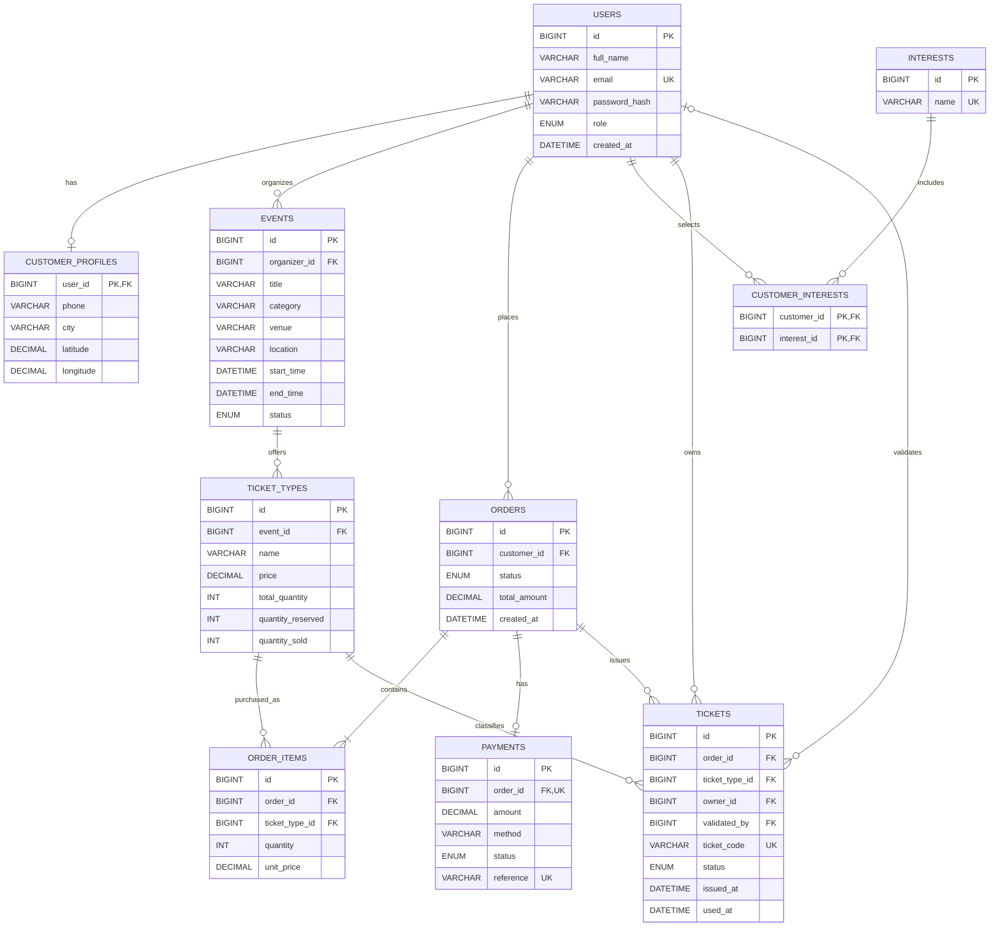

# Ticket Master Entity Relationship Diagram (ERD)

The diagram below shows the main entities in the Ticket Master database and their relationships.

## Notes

- `PK` means primary key.
- `FK` means foreign key.
- `UK` means unique key.
- A customer profile is optional, but each profile belongs to one user.
- Each event has one organizer.
- Each ticket type belongs to one event.
- An order may have zero or one payment record in the current design.
- A ticket's `validated_by` field is optional until a validator checks the ticket.
